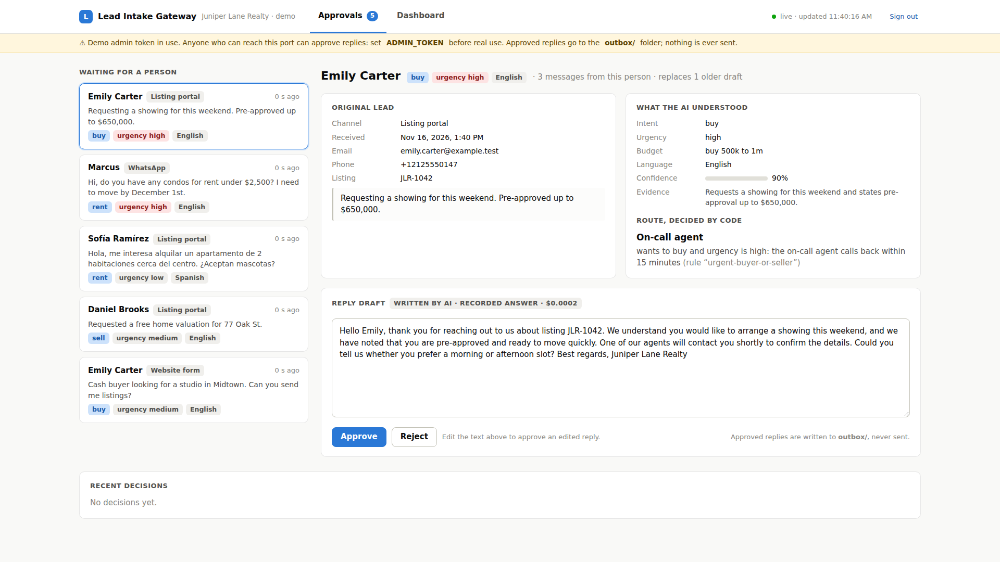
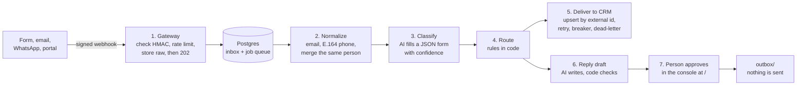
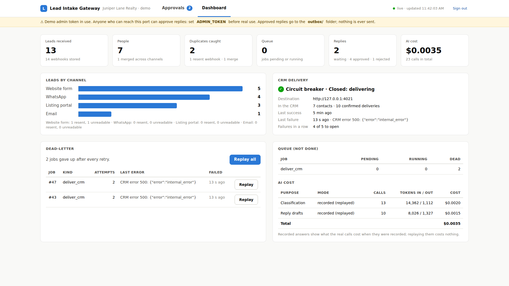
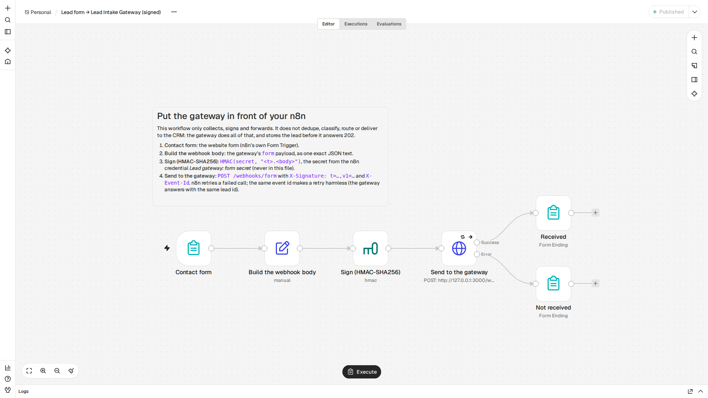
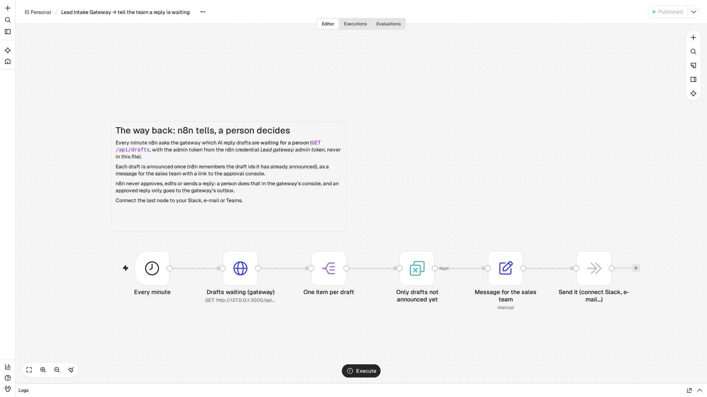
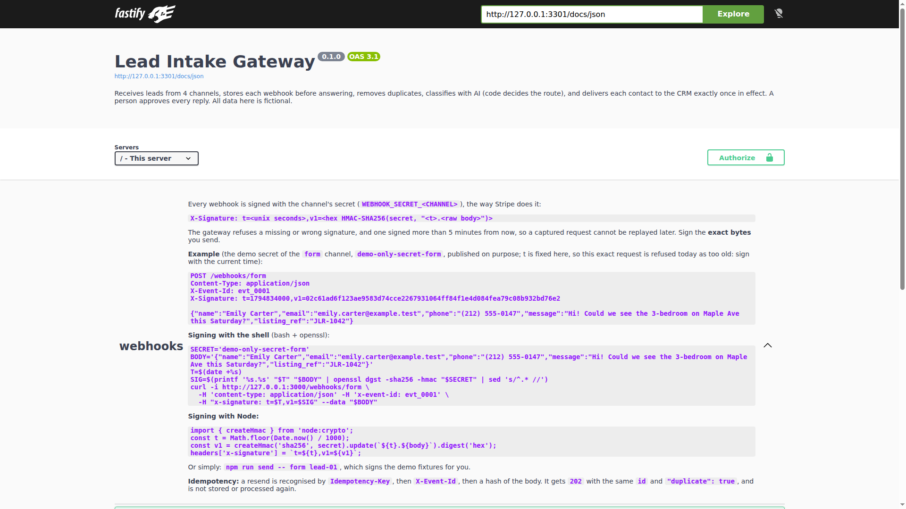

# Lead Intake Gateway

Leads arrive from a website form, email, WhatsApp and a listings portal. Providers resend webhooks, the same person writes on three channels, and the CRM is sometimes down. This gateway stores every lead before it answers, merges duplicates, and delivers each contact to the CRM once, even through outages.

https://github.com/user-attachments/assets/079af3ce-0172-4515-885e-9e6fe1fefcf4

[](https://github.com/leofreitas-dev/lead-intake-gateway/actions/workflows/ci.yml) [](LICENSE) [](https://nodejs.org)



*The approval queue: the urgent buyer first. Each lead shows the original message, what the AI understood (with its confidence), the route the code chose and why, and a reply draft to approve, edit or reject.*

- **AI classifies** each lead (intent, urgency, budget, language) and drafts a reply. Its answer is a JSON form, validated, with a confidence.
- **Code decides** everything else: the route, deduplication, retries, CRM delivery. 284 tests, plus a chaos run that takes the CRM down while about 300 leads are still in the queue.
- **A person approves** every reply. Nothing is sent: an approved reply is written to `outbox/`.

Runs without an API key and without a database server: demo mode replays recorded answers from the real AI, and Postgres starts embedded.

## Try it in two minutes

Requires Node 24 or later. No API key, no database server, no Docker.

```
npm install
npm run demo       # 13 webhooks over 4 channels, end to end, in the terminal
```

To click through it:

```
npm run crm        # terminal 1: the fake CRM on 127.0.0.1:4010
npm start          # terminal 2: the gateway; approval console at http://127.0.0.1:3000
npm run send -- form lead-01   # terminal 3: send one fictional lead (see fixtures/README.md)
npm run crm:mode -- down       # take the fake CRM down, send more, watch the Dashboard; then: -- ok
npm test           # 284 tests
```

## How it works



A webhook is written to Postgres, with its job, in one transaction before the gateway answers `202`: if the process dies right after, the lead is there. Workers take jobs from the same Postgres (`FOR UPDATE SKIP LOCKED`), so a crash only delays work. The AI fills a fixed form and never picks the route; a few lines of tested code do, and write down why. CRM delivery is an upsert by a stable external id, so a retry after a lost answer updates the same record instead of creating a second one.

## Every error path has an exit

| Situation | What happens |
|---|---|
| The CRM is down | Deliveries wait in the queue. After 5 failures in a row the circuit breaker opens and stops calling for 15 s, then lets one trial delivery through. Nothing is lost. |
| The CRM answers 429 | All deliveries pause for its `Retry-After`. A 429 does not open the breaker: the CRM is up, just busy. Our own rate limit stays under the CRM's. |
| The CRM answers 500 | Retried with exponential backoff and full jitter, up to 10 attempts, then the dead-letter, with a Replay button. |
| The CRM refuses the data (4xx) | Straight to the dead-letter with the CRM's message: retrying would not fix it. |
| A provider resends the same webhook | Recognised by `Idempotency-Key`, `X-Event-Id` or a hash of the body. Same `202`, same id, nothing stored or processed twice. |
| The same person on three channels | Email lowercased, phone in E.164 (`(212) 555-0147`, `12125550147` and `+1 212.555.0147` are one number): one contact, with a timeline of every lead. Names never merge people. |
| A wrong or old signature | `401`. A signed request older than 5 minutes is refused, so a captured one cannot be replayed. |
| A worker dies mid-delivery (`kill -9`) | Its lease runs out and another worker sends it again. The CRM may already have it; the upsert makes the second call update the same record. |
| The database is down | `503`, so the provider retries later. `/ready` turns red; `/health` stays green (restarting would not fix the database). |
| The AI is unsure (confidence below 0.70), answers invalid JSON twice, or refuses | The lead goes to manual review, with the reason. No draft. |
| Spam | Archived: not delivered to the CRM, no reply draft. |
| A vendor (a photography studio offering services) | Routed to the general inbox, not to sales. No reply draft. |
| A reply draft names a price, availability or a time the lead did not ask for, or a link or contact details | Rejected by a check in code and drafted again. After two failures the console says "write it by hand". |

## Proof

**Chaos.** `npm run chaos` starts real processes (Postgres, the fake CRM, the gateway and a second worker process) and sends 338 signed webhooks: 297 leads from fictional people, plus 41 resends. Right after the burst the CRM is down for 60 s, then answers 429 for 15 s and 500 for 15 s, and the worker process is killed with `kill -9` while it holds a delivery. The result is compared with a plan computed beforehand, not with what the system says about itself.

| | Run 1 | Run 2 | Run 3 |
|---|---|---|---|
| Lost | 0 | 0 | 0 |
| Duplicated in the CRM | 0 | 0 | 0 |
| Dead-letter | 0 | 0 | 0 |
| Delivery retries | 40 | 40 | 40 |
| Circuit breaker opened | 11× | 11× | 11× |
| CRM back → queue empty | 41.5 s | 41.5 s | 41.0 s |

Command: `npm run chaos` (seed 1, commit `b9e3481`). Reports: [run 1](reports/chaos-seed1-20261116T140232.md), [run 2](reports/chaos-seed1-20261116T140451.md), [run 3](reports/chaos-seed1-20261116T140711.md), [all runs](reports/chaos-runs.md).

**Throughput.** `npm run bench` starts its own Postgres, the fake CRM and the gateway, then sends signed webhooks: 200 per second on a fixed schedule for 15 s (latency counted from when each request was due), then 32 connections flat out for 15 s. Every `202` is checked against the database.

| Median of 3 runs | Result |
|---|---|
| p50 at 200 requests/s | 13.3 ms |
| p95 at 200 requests/s | 28.9 ms |
| Most requests/s accepted | 396 |
| Lost | 0 in every run (28,286 accepted requests in total, each checked against the database) |

Command: `npm run bench` (commit `8b94d70`; AMD Ryzen 5 5500, 12 logical CPUs, WSL2, client on the same machine). Reports: [run 1](reports/bench-20261116T150910.md), [run 2](reports/bench-20261116T150949.md), [run 3](reports/bench-20261116T151029.md), [all runs](reports/bench-runs.md), including 3 runs with HTTP and workers in separate processes (`--layout split`). These are numbers for one desktop PC, not a production claim.

## Cost

Claude Haiku 5.5 classifies every lead and drafts a reply for 8 of them. The 11 demo leads cost US$ 0.0029 in total (19 calls, 18,602 input and 2,016 output tokens): **about US$ 0.26 per 1,000 leads**. Prices are in [`config/pricing.json`](config/pricing.json), with the source (Anthropic's pricing page) and the date they were checked (2026-11-16). Every AI call is stored with its tokens and cost, and the dashboard adds them up.

## What the team sees



*The demo with the fake CRM answering 500 and attempts set to 2 (the default is 10) to fill the dead-letter quickly: two deliveries gave up and wait there with a Replay button. Also on screen: leads per channel, duplicates caught, the circuit breaker (4 of 5 failures) and the AI cost by purpose.*

## Works with your CRM

Delivery goes through one small interface. The delivery worker knows nothing else about the CRM:

```ts
export interface CrmClient {
  readonly name: string; // the circuit breaker is per destination
  upsertContact(contact: CrmContact, ctx: { traceId: string | null }): Promise<UpsertResult>;
}
```

`CrmContact` is the whole contact as it is now (name, emails, phones, owner and why, intent, urgency, budget, lead count, merged ids), keyed by a stable `externalId`. Retries, backoff, the circuit breaker, rate limiting and the dead-letter live in the worker, so they work the same for any CRM. An adapter only has to turn the contact into the CRM's upsert call and sort its errors:

```ts
export class PipedriveClient implements CrmClient {
  readonly name = 'pipedrive';
  async upsertContact(contact: CrmContact): Promise<UpsertResult> {
    // 1. find the person by externalId (a custom field), or create it
    // 2. send the whole contact, so a repeated call ends in the same record
    // 3. throw CrmError('rate_limited' | 'server_error' | 'rejected' | ...) on failure
  }
}
```

Today the only adapter included is the fake CRM (`src/crm/http-crm.ts`, 52 lines, and `npm run crm`), which can fail on demand (down, slow, 429, 500) so the chaos run can prove the delivery rules. A HubSpot adapter is the next one; it is not written yet.

## Put the gateway in front of your n8n

For a team that already runs n8n: n8n collects the lead and tells people when a reply waits; the gateway keeps the logic, so there is one copy of it. Two workflows in [`n8n/`](n8n/README.md):

- **Contact form → gateway:** an n8n form signs the lead (HMAC-SHA256, the secret in an n8n credential) and posts it to `/webhooks/form`. The person sees the gateway's reference, or "try again" if it did not answer.
- **Replies waiting:** every minute n8n asks the gateway which reply drafts wait for a person and announces each one once. It never approves anything.



*The form workflow: collect, build the exact body, sign, send. No deduplication, classification or routing in n8n.*



*The way back: n8n reads `GET /api/drafts` and announces each new draft once; the last node is where Slack or email goes.*

## Observability and API

- **`/metrics`** in the Prometheus format: webhooks by channel and outcome, a latency histogram, the queue by job kind (pending, running, dead, oldest waiting), retries and replays, the circuit breaker, AI calls, tokens and cost.
- **`/docs`**: OpenAPI 3.1 built from the real routes, served offline (no CDN), with a signed request you can copy in bash or Node.
- **Logs** in JSON (pino), with a trace id born at the webhook and carried to the CRM call (`x-request-id`).
- **`/health`** (the process is alive) and **`/ready`** (it can reach the database).



*The API docs at `/docs`: how to sign a webhook, with an example request signed with the published demo secret.*

## Configuration

Every setting is optional and listed in [`.env.example`](.env.example): ports, `DATABASE_URL` (empty means embedded Postgres), one webhook secret per channel, rate limits, CRM timeouts, attempts, backoff and breaker, worker roles (`ROLE=all`, `worker` or `http`) and the admin token. With `NODE_ENV=production` the gateway refuses to start on demo secrets.

Live AI (costs money; the demo does not need it):

```
cp .env.example .env      # then set AI_MODE=live and ANTHROPIC_API_KEY in .env
npm start
```

## Project layout

```
src/gateway       POST /webhooks/:source: signature, rate limit, store-before-202, idempotency
src/leads         channel adapters, normalization, identity (merging contacts), classification job
src/ai            Claude calls, the JSON schema, recorded answers, pricing
src/routing       routing rules in code
src/queue         the Postgres job queue and workers
src/delivery      CRM delivery: retries, backoff, circuit breaker, rate limit, dead-letter
src/crm           the CrmClient interface and the HTTP client of the fake CRM
src/replies       reply drafts, the check in code, approve / edit / reject
src/admin         approval console and dashboard (one HTML page, no CDN), admin API
src/observability /metrics
src/docs          OpenAPI schemas
src/cli           demo, send, replay, fake CRM, chaos, bench, local n8n
migrations/       SQL migrations
fixtures/         fictional webhooks and recorded AI answers
n8n/              two n8n workflows and their notes
reports/          chaos and bench reports
test/             Vitest
```

## Notes

- Every person, company, email (`.test` domains) and phone number (`555-01xx`, reserved for fiction) is invented. Juniper Lane Realty does not exist.
- Nothing is ever sent: an approved reply is written to `outbox/`.
- The demo replays recorded AI answers. A new message typed in goes to manual review unless `AI_MODE=live`.
- The only CRM adapter included is the fake one.
- It runs on one machine, with Postgres as the queue. The numbers above come from one desktop PC, not from production.
- The console listens on 127.0.0.1 with a bearer token. It is a local demo, not a hosted product.

## About

Built by Leonardo Freitas. I build AI automations that don't break: lead intake, quote desks, n8n workflows, self-hosted or cloud.

If your leads arrive on several channels and some get lost or land in the CRM twice, get in touch.

- Book a 20-min intro call: https://cal.com/leofreitas-dev/intro
- Email: leonardofreitasdev06@gmail.com
- GitHub: https://github.com/leofreitas-dev

Built with AI agents (Claude Code) under my direction.

## License

MIT. See [LICENSE](LICENSE).
